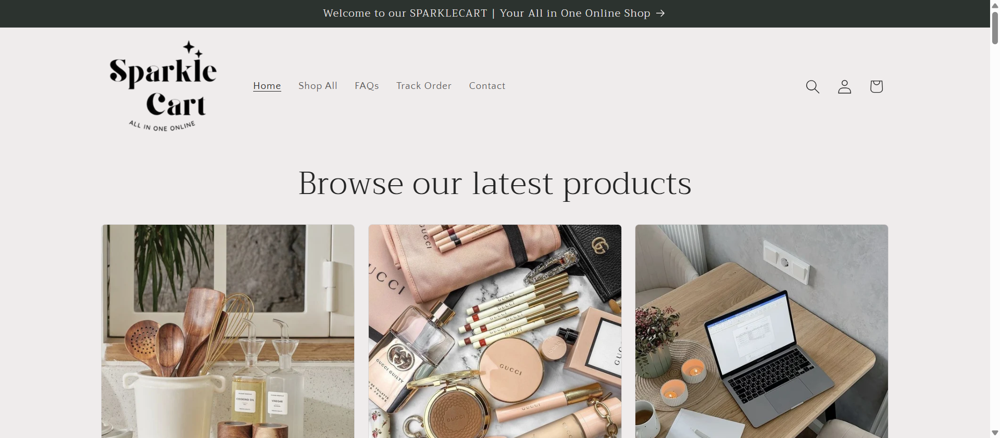
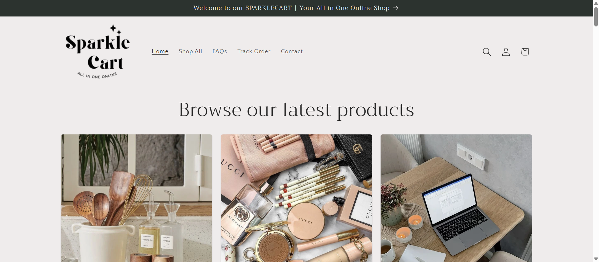

 # **ROBOT FRAMEWORK SELENIUM AUTOMATION**

Enterprise-inspired Robot Framework Automation Framework demonstrating UI automation, reusable keywords, data-driven testing, Selenium Library, Excel & CSV integration, browser management, waits, screenshots, alerts, frames, and automation best practices.

 
 
 
 
 
 

This repository demonstrates a modular Robot Framework automation project implementing reusable automation components, SeleniumLibrary, data-driven testing, reusable resource files, browser management, synchronization strategies, reporting, and automation best practices.

Architecture
                 Test Cases

                      │

                      ▼

             Robot Framework Engine

                      │

        ┌─────────────┼──────────────┐

        ▼             ▼              ▼

  Resource Files   Test Data    SeleniumLibrary

        │             │              │

        ▼             ▼              ▼

Reusable Keywords  CSV/Excel     Browser Actions

        │             │              │

        └─────────────┼──────────────┘

                      ▼

                Test Execution

                      │

                      ▼

              HTML/XML Reports
Framework Features

Instead of just listing files, group them into capabilities.

Browser Management

✔ Browser Launch

✔ Browser Close

✔ Multiple Browser Support

✔ Navigation

UI Components

✔ Input Box

✔ Buttons

✔ Radio Buttons

✔ Dropdown

✔ Frames

✔ Alerts

✔ Windows

✔ Links

✔ Scrolling

Synchronization

✔ Implicit Wait

✔ Selenium Timeout

✔ Explicit Synchronization

Data Driven Testing

✔ CSV

✔ Excel

✔ External Test Data

Keyword Driven

✔ User Keywords

✔ Resource Files

✔ Parameterized Keywords

✔ Return Values

Reporting

✔ HTML Reports

✔ XML Output

✔ Execution Logs

✔ Screenshots

Skills Demonstrated
Robot Framework

Python

SeleniumLibrary

Test Automation

Keyword Driven Testing

Data Driven Testing

Reusable Components

Synchronization

Cross Browser Testing

Automation Framework Design

CSV Integration

Excel Integration

Reporting

UI Automation

Test Case Design

QA Best Practices
Recruiter Snapshot

This is the section most repositories miss.

## 💼 Recruiter Snapshot

This repository demonstrates practical experience in:

✔ Robot Framework

✔ Selenium Automation

✔ Python Automation

✔ Modular Test Framework Design

✔ Keyword-Driven Automation

✔ Data-Driven Testing

✔ Browser Automation

✔ Test Reporting

✔ Automation Best Practices

The project reflects skills expected from Automation Test Engineers, QA Engineers, SDETs, and Quality Engineers working on enterprise web applications.
Add Screenshots

Your repository already contains:

LoginTC.png

Logo.png

selenium-screenshot-1.png

selenium-screenshot-2.png

report.html

log.html

Show them like:

## 📸 Execution Screenshots

### Login Automation

---

### Test Execution

---

### Browser Automation

Future Improvements
- Parallel Execution

- Docker Integration

- Jenkins CI/CD

- GitHub Actions

- BrowserStack Integration

- Allure Reports

- Playwright Library

- API Automation

- Accessibility Testing

- Hybrid Automation Framework
About Me

Considering your profile:

## 👨‍💻 About Me

Automation Test Engineer with 6+ years of experience in UI Automation, API Testing, Accessibility Testing, AI-powered Testing, Playwright, Selenium, Robot Framework, Java, Python, and CI/CD.

Passionate about building scalable automation frameworks and exploring AI-driven software testing.
